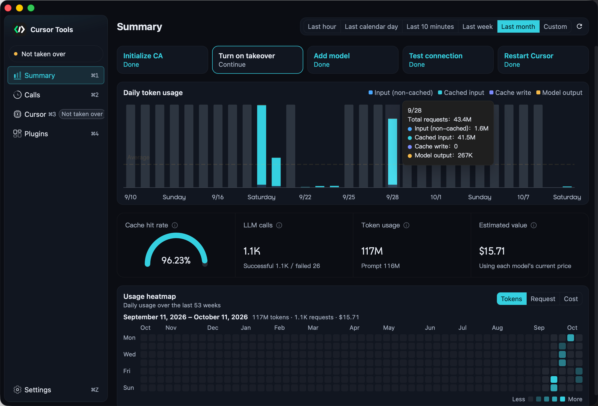
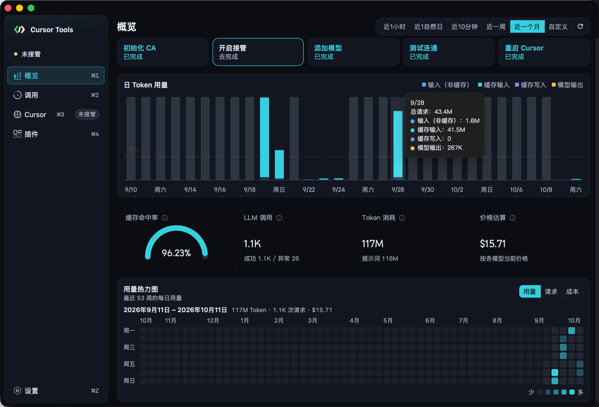
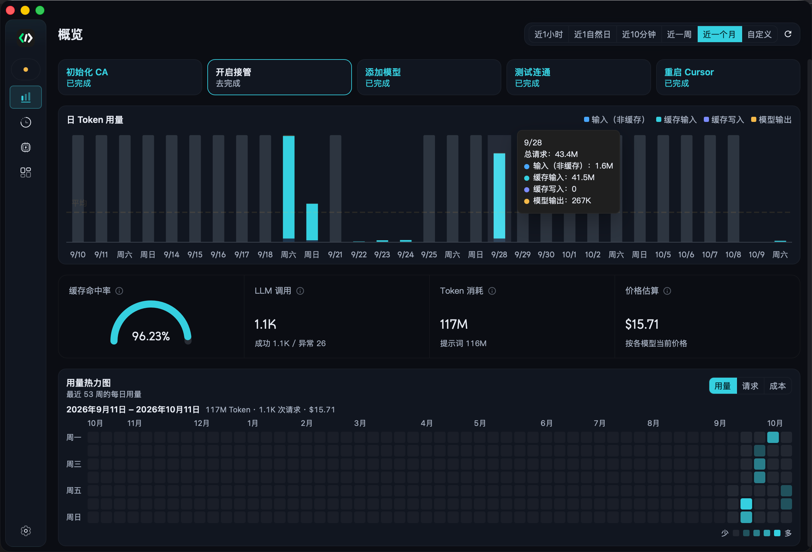
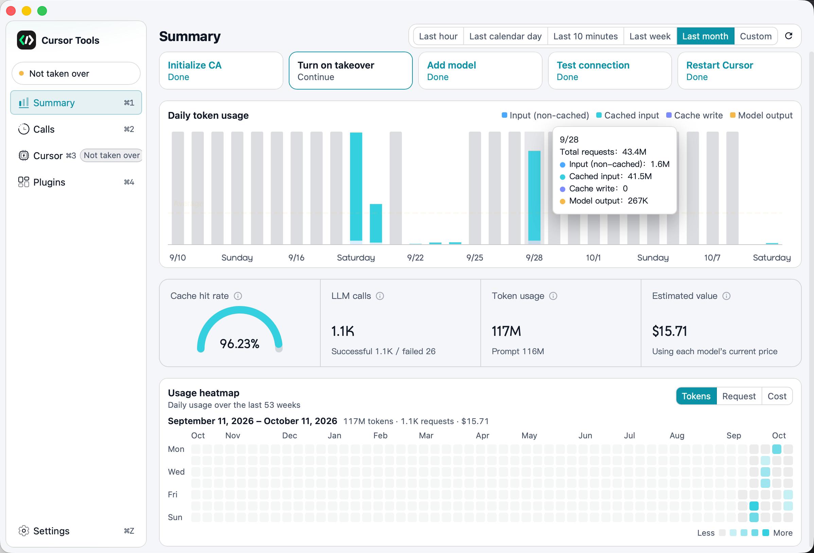
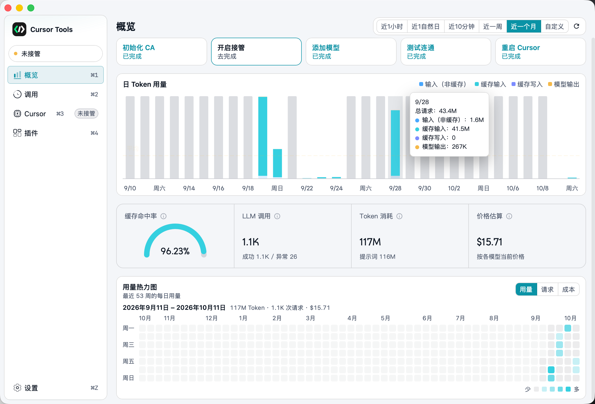
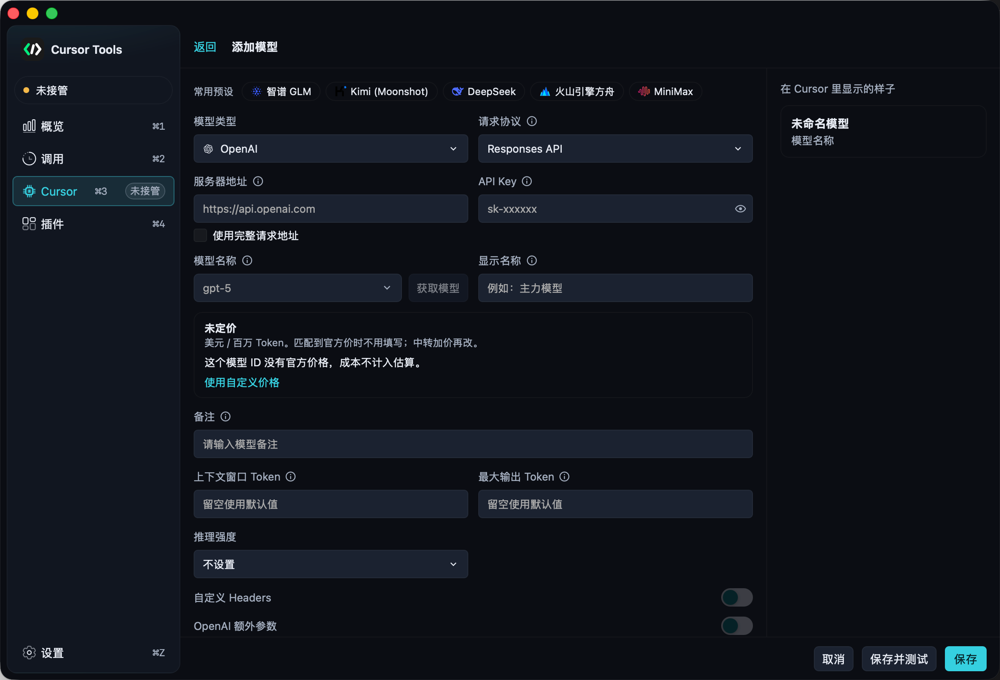

# cursor-tools

cursor-tools 是一个运行在本机的 Cursor 模型网关，帮助你在 Cursor 中使用自己配置的模型服务。

[English README](./README.md) · [使用帮助](https://ops.susuan.ai/download/guide.html) · [下载](https://ops.susuan.ai/download/) · [提交问题](https://github.com/moralmaker/cursor-toosl/issues)













## 项目简介

cursor-tools 是一个开源的本地模型网关。它在你的设备上运行服务，接收 Cursor 发出的 Agent 请求，将请求转发到你配置的模型服务，并尽可能保留 Cursor Agent 的工具调用、Skills、MCP 和多轮对话能力。

你可以连接兼容 OpenAI 或 Anthropic 协议的服务，自定义服务地址、模型 ID、API Key 和请求参数，也可以使用 Cursor 平台默认选项之外的模型通道。

> [!IMPORTANT]
> cursor-tools 免费且开源，但你连接的模型服务商可能会按用量收费。本项目是独立项目，与 Cursor 或其开发者没有关联，也未获得其认可。


## 主要功能

- **自定义模型通道**：配置自己的 API 地址、凭据和模型 ID。
- **多种 API 协议**：支持 OpenAI Responses API、OpenAI Chat Completions API 和 Anthropic Messages API 兼容服务。
- **模型管理**：添加、复制、编辑、排序模型配置，并批量测试连接。
- **连接性能测试**：查看首字延迟、生成速度、总耗时和原始服务商响应。
- **Agent 工作流**：继续使用工具调用、Skills、MCP 和多轮对话。
- **会话指标**：查看 Token 用量、缓存命中率、对话轮次和估算价值。
- **TAB 补全服务**：在公益服务、官方直连和自定义服务之间选择连接方式。
- **跨平台运行**：支持 macOS、Windows 和 Linux。


## 快速开始

1. 打开 [下载页](https://ops.susuan.ai/download/)，按设备提示下载最新版本（也可在 [GitHub Releases](https://github.com/moralmaker/cursor-toosl/releases/latest) 获取）。
2. 启动 cursor-tools，打开 **Cursor 配置**，按提示初始化本地 CA（证书颁发机构）。
3. 在模型设置中添加模型，填写服务地址、API Key 和模型名称，然后保存并运行 **测试**。
4. 确认测试通过后，保持 cursor-tools 运行。
5. **首次升级 Cursor 或首次配置模型后，完全退出并重新启动 Cursor，然后新开一个对话**。在模型列表中选择已配置的模型，开始使用 Agent。

完整的安装步骤、配置说明和常见问题，请参阅[使用帮助](https://ops.susuan.ai/download/guide.html)。

> [!TIP]
> 首次升级 Cursor 或首次完成配置后，必须完全退出并重新启动 Cursor，再新开一个对话。配置前已经打开的对话不会加载新连接；使用自定义模型时，请在模型列表中手动选择该模型，不要选择 **Auto**。


## 模型配置

每个模型配置都是独立的上游通道，可以单独设置服务商、协议、凭据和生成参数。



### 类型与协议选择


| 模型系列            | 模型类型          | 请求协议                     |
| --------------- | ------------- | ------------------------ |
| Claude 系列       | **Anthropic** | Messages API             |
| GPT / OpenAI 系列 | **OpenAI**    | **Responses API**        |
| 其他模型            | **OpenAI**    | **Chat Completions API** |


GPT 系列建议使用 **Responses API**。如果使用 Chat Completions，可能无法保留提示词缓存，导致速度变慢和费用增加。

### 常用字段

- **模型类型**：选择 OpenAI 或 Anthropic，决定上游接口格式。
- **请求协议**：OpenAI 类型需要继续选择 Responses API 或 Chat Completions API。
- **服务器地址**：可以填写服务商基础地址，让应用按协议追加标准端点，也可以填写完整请求 URL 并原样使用。
- **API Key**：填写上游服务要求的访问密钥。密钥保存在本机，用于发送模型请求。
- **模型名称**：填写服务商接口接受的模型标识，也可以使用 **获取模型** 读取服务商返回的模型列表。
- **显示名称**：Cursor 模型列表中显示的名称，不会改变发送给上游的模型标识。
- **备注**：显示在 Cursor 的模型说明中。

还可以根据模型能力设置上下文窗口 Token、最大输出 Token、推理或思考强度、自定义 Headers，以及 OpenAI 或 Anthropic 的额外参数。自定义 Headers 和额外参数必须是 JSON 对象，只应填写服务商明确支持的字段。

保存配置后运行 **测试**，确认地址、协议、API Key、模型标识和流式响应都正常，再在 Cursor 中使用该模型。

## TAB 补全服务

Cursor 的 Tab 补全由独立的 TAB 服务处理，不经过模型通道。你可以在 **系统设置 → TAB 设置** 中选择以下模式：

- **使用公益服务（默认）**：使用项目作者部署的公共服务，无需额外配置。
- **直连**：直接连接当前 Cursor 账号对应的官方 TAB 服务，适合账号拥有官方额度的情况。
- **自定义**：自行部署本仓库 [`crates/tab-server`](crates/tab-server/README.md)，然后填写 TAB 服务地址。

修改 TAB 设置后，建议重启 Cursor 并新开一个对话，确保新的连接方式生效。

## 与官方账号并存

新版设计支持 cursor-tools 与 Cursor 官方服务并存：

- 直接在 Cursor 中登录自己的账号。如果之前使用旧版生成的 fake 账户，请先退出该账户，再登录自己的账号。
- 账号拥有官方额度时，官方模型和本地模型可以随时切换混用。
- **Auto 只使用官方模型**，不会自动使用你配置的本地模型。账号没有官方额度时，请手动选择自己配置的模型。
- 插件、代码库索引等 Cursor 功能可以继续使用。


## 数据流转

```text
Cursor 客户端
    │
    │ Agent 请求与工具结果
    ▼
cursor-tools 本地服务
    │
    │ OpenAI / Anthropic 兼容请求
    ▼
你配置的模型 API
```

API Key、模型配置和应用设置保存在本机。模型请求仍会发送到你选择的上游服务商，请根据对应服务商的隐私政策和计费规则使用。

## 项目结构

```text
cursor-tools/
├── apps/
│   └── desktop/
│       ├── src/
│       │   ├── features/ # 首页、模型、调用记录、插件与设置
│       │   ├── shell/    # 窗口框架、页面布局与广告外壳
│       │   ├── shared/   # UI、虚拟列表、状态、API 与平台能力
│       │   ├── i18n/     # 本地化运行时与语言目录
│       │   └── styles/   # 全局主题与排版令牌
│       └── src-tauri/    # Tauri 桌面生命周期与便携更新
├── server/
│   ├── src/
│   │   ├── api/       # HTTP / Connect 路由
│   │   ├── cursor/    # Cursor 协议适配、Agent 编译、Checkpoint、Tools、Services
│   │   ├── run/       # 通用 Agent Runtime 与内部 Port
│   │   ├── provider/  # 模型供应商适配
│   │   ├── plugin/    # 文件系统插件：发现、Deno 沙箱 worker、插件 Provider
│   │   ├── model/     # 聚合领域模型
│   │   ├── store/     # SQLite Repository 与迁移
│   │   ├── control/   # 管理面 API
│   │   ├── local_app/ # Cursor 本地集成：代理、CA、接管
│   │   └── search/    # Web 与 Semble 搜索接入
│   ├── plugins/       # 内置插件（codex-auth、grok-auth、antigravity-auth）
│   ├── prompt/
│   └── migrations/
├── crates/
│   ├── semble-core/   # 本地代码索引与搜索核心库
│   └── tab-server/    # 公益 / 自建 Cursor TAB 代理
├── protocols/
│   └── cursor/        # server/build.rs 使用的 Cursor protobuf 定义
├── ops/               # Cloudflare Worker：广告下发、桌面更新清单与管理台
├── support/                     # 仓库辅助设施
│   ├── cursor-protocol-extractor/ # Cursor 协议提取与 Go 代码生成工具
│   ├── cursor-capture/            # Cursor 协议抓取和调试工具
│   └── benchmarks/                # 代码搜索和索引基准测试
├── docs/              # 发版流程、服务端架构、外部接口契约
├── .github/workflows/ # ci.yml 检查；release.yml 由 v* 标签触发多端发版
├── images/            # README 展示图片
├── Cargo.toml         # Rust 工作区配置
└── Makefile           # 常用开发、检查和构建命令
```


## 本地开发


### 环境要求

- Rust **stable** 工具链,并安装 `rustfmt` 与 `clippy` 组件
- Node.js **22** 与 npm
- Tauri 2 的系统构建依赖
- Docker(仅在构建 Docker 镜像时需要)


### 安装依赖

```bash
npm --prefix apps/desktop ci        # 按 package-lock.json 精确安装
```


### 启动本地服务(构建产物)

先构建前端与服务端(见下方「构建」),再启动本地网关服务,浏览器打开 [http://127.0.0.1:3000](http://127.0.0.1:3000) 即为控制台(健康检查:`/__tools-api__/healthz`):

```bash
CURSOR_CONSOLE_DIR=apps/desktop/dist cargo run --release --package cursor-server --bin cursor-server
```

桌面 GUI 也可以直接运行 `dist/desktop/` 下的主程序或安装 NSIS 安装包;在 **模型设置** 中配置端点与密钥后点击 **启动服务**,配置或升级 Cursor 后需完全退出并重启 Cursor,再新开对话使用已配置模型。

### 启动开发环境(热更新)

```bash
make dev-web         # 等价 npm --prefix apps/desktop run dev:web:cargo server(:3000 代理模式)+ vite dev(:1420)
make dev-desktop     # 等价 npm --prefix apps/desktop run tauri:dev,桌面壳开发
make dev-tab-server  # 本地 TAB 代理(:8041),未提供 config.toml 时回退到 crates/tab-server/config.example.toml
```


### 检查(与 CI 对齐)

```bash
cargo fmt --all -- --check
cargo clippy --workspace --all-targets -- -D warnings
cargo test --workspace --all-targets
npm --prefix apps/desktop run check        # tsc typecheck ×2 + vite 生产构建
```

`make check` 依次执行以上四条,与 CI 工作流(`.github/workflows/ci.yml`)一致。

### 构建

```bash
# Web 控制台       -> apps/desktop/dist
npm --prefix apps/desktop run build

# 本地网关服务      -> target/release/cursor-server(.exe)
cargo build --release --package cursor-server --bin cursor-server

# 桌面安装包(NSIS)+ updater 签名
cd apps/desktop
TAURI_SIGNING_PRIVATE_KEY="$(cat ../.tauri/cursor-tools.local.key)" \
TAURI_SIGNING_PRIVATE_KEY_PASSWORD='' \
  npx tauri build --bundles nsis
```

`make build-web` / `make build-server` / `make build-desktop` / `make build-docker` / `make build-tab-server` / `make build-tab-server-docker` 是上述命令的封装(本地 Tauri 签名密钥 `.tauri/cursor-tools.local.key` 由 `make build-desktop` 自动生成)。

正式多端安装包由 GitHub Actions 在推送 `v*` 标签后构建,改版本号与发版步骤见 [`docs/README.md`](./docs/README.md)。

### Windows ARM64 + 共享盘(SMB)环境注意事项

本机默认工具链为 `aarch64-pc-windows-msvc`,但安装的 MSVC 只有 x64 库,且 `rustc` 归档写入 SMB 共享盘会报 `os error 87`。请改用 x64 主机工具链并把构建产物放到本地盘:

```powershell
# 会话级一次性操作:把仓库共享映射为盘符(cmd/npm 不支持 UNC 工作目录)
net use W: \\Mac\Home\Desktop /persistent:no
cd W:\Mywork\Coding\Tools\cursor-tools

$env:RUSTUP_TOOLCHAIN   = 'stable-x86_64-pc-windows-msvc'      # x64 二进制经模拟运行
$env:CARGO_TARGET_DIR   = 'C:\Users\moral\AppData\Local\Temp\ctarget'
cargo clippy --workspace --all-targets -- -D warnings
cargo test  --workspace --all-targets
cargo build --release --package cursor-server --bin cursor-server
```

本机桌面打包(tauri CLI 在 ARM64 node 下会误判架构;签名密钥密码不能为空字符串,否则 CLI 会交互式弹密码导致无终端挂起):

```powershell
cd apps/desktop
$env:TAURI_SIGNING_PRIVATE_KEY         = (Get-Content '..\..\.tauri\cursor-tools.local.key' -Raw).Trim()
$env:TAURI_SIGNING_PRIVATE_KEY_PASSWORD = 'cursor-tools-local'
node node_modules/@tauri-apps/cli/tauri.js build --bundles nsis --target x86_64-pc-windows-msvc
```

产物分别位于 `$env:CARGO_TARGET_DIR\release\`(服务端)与 `dist\desktop\`(安装包 + `.sig` + 免安装主程序,已被 gitignore)。注意:对非 workspace 成员的 crate 使用 `cargo build -p <crate>` 可能触发 cargo 1.98 的特性解析器 panic,请改用 `--workspace` 或 `-p` 指定 workspace 成员(如 `-p cursor-server`)。

## 路线图

项目将继续改进模型兼容性、Agent 工具、本地运行稳定性和自托管体验，并探索支持更多 IDE、聊天和 Agent 工作流。

计划与进展请参阅[发布路线图](https://github.com/moralmaker/cursor-toosl/discussions/32)。

## 社区与反馈

- [使用帮助](https://ops.susuan.ai/download/guide.html)
- [GitHub Issues](https://github.com/moralmaker/cursor-toosl/issues)

提交问题时，请附上操作系统、cursor-tools 版本、模型类型、请求协议、已脱敏的服务地址、错误信息和复现步骤。请勿公开 API Key 或其他凭据。

## 参与贡献

欢迎提交 Issue 和 Pull Request。提交代码前请先阅读项目中的开发说明，并运行 `make check` 确认格式、测试和前端构建检查通过。

## 许可证

本项目采用 [MIT License](./LICENSE) 开源。